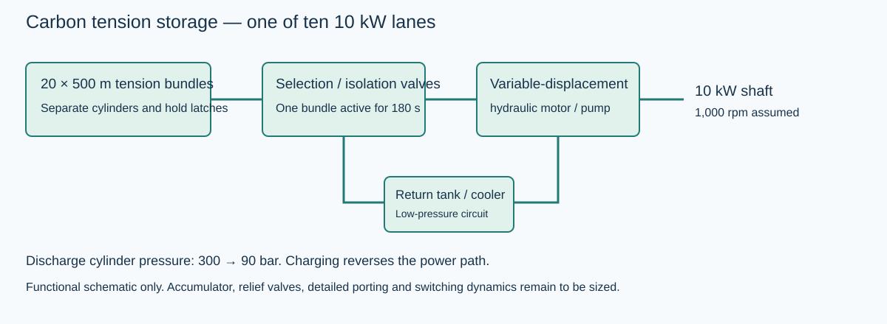
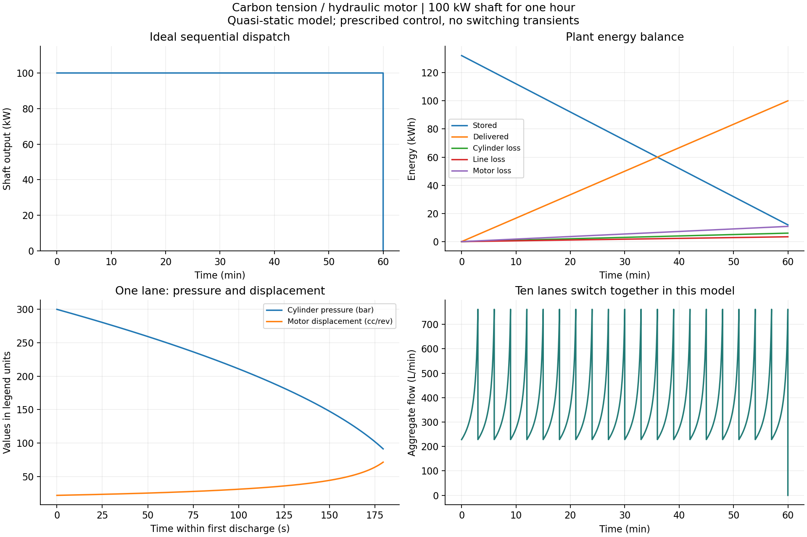

# Carbon tension storage with hydraulic output

**Study date:** 25 October 2026  
**Duty:** 100 kW mechanical shaft power for one hour, 100 kWh delivered  
**Status:** parameterized, simulated quasi-static engineering concept; not fabrication drawings or a qualified design

## 1. Outcome

A carbon tension store can be represented consistently as elastic bundles driving hydraulic cylinders and variable-displacement motors. Four OpenModelica simulations deliver 100 kWh with the specified loss assumptions. The preferred geometry for further development uses **200 bundles, each 500 m long**, and ten 10 kW conversion lanes. This stays below the permitted 1,000 m straight length.

Using commercial T1100G fibre properties at an assumed 3.5 GPa peak stress requires **45.04 tonnes of active fibre**. The hydraulic system transfers **21.09 cubic metres of oil** over a full discharge. With dedicated single-acting cylinders, this implies at least about **17.93 tonnes of working oil**, assuming 850 kg/m³, plus dead-volume and auxiliary inventory. The active-fibre-plus-working-oil subtotal is therefore **62.97 tonnes**, excluding cylinders, supports, tanks, terminations, motors, valves and containment. It is not total plant mass.

The modeled discharge efficiency is **83.17%**. Assuming the same efficiency in reverse gives a **69.16% shaft-to-shaft refill-cycle estimate**. Charge transients, material hysteresis, storage relaxation and auxiliary loads are excluded. These are scenario results, not measured efficiencies.

## 2. Material evidence and design assumptions

[Toray's T1100G datasheet](https://www.toraycma.com/wp-content/uploads/T1100G-Data-Sheet.pdf) lists typical fibre tensile strength 7 GPa, modulus 324 GPa, density 1,790 kg/m³ and filament diameter 5 µm. These are fibre properties, not guaranteed allowables for long bundles, grips or a repeatedly loaded plant. This study chooses 3.5 GPa and 2 GPa as sensitivity cases; neither is a certified fatigue limit. Matrix, sizing and termination mass are excluded from the fibre mass calculation.

An [experimental CNT-fibre study published in 2026](https://www.nature.com/articles/s41467-026-75150-1) reports strength 12.5 GPa, modulus 370 GPa and specific strength 7.5 N/tex. The latter implies a density of approximately 1,667 kg/m³ when combined with the reported absolute strength. We use 6.25 GPa as a speculative operating-stress scenario. Combining these headline properties with a linear elastic law does **not** establish that the calculated work is reversibly recoverable or sustainable over repeated cycles.

The previous [CNT torsional study](https://www.nature.com/articles/s41565-024-01645-x) concerns a different deformation mechanism. Its 2.1 MJ/kg result is not applied to this axial-tension system.

All cases assume ideal load sharing among filaments, uniform stress, no grip slip, no material hysteresis and no time-dependent stress relaxation. Those assumptions are particularly uncertain for CNT assemblies.

## 3. Functional architecture

The plant has ten independent high-pressure hydraulic lanes. Each lane contains twenty tension bundles, twenty dedicated single-acting cylinders, holding latches and a selection manifold. One bundle per lane discharges for 180 seconds. Its cylinder expels oil through the selected branch to a variable-displacement hydraulic motor. The motor returns oil to the low-pressure reservoir. Ten motor outputs provide 100 kW in aggregate; a common shaft or downstream electrical aggregation would need a separate mechanical/electrical design.

The selected bundle supplies 0.5 kWh shaft energy. Each lane supplies 10 kWh across twenty slots. The simulation switches all ten lanes simultaneously. In hardware, overlapping release and a properly sized accumulator or other buffer would be required to bridge handovers. Staggering the lanes could reduce aggregate flow variation but has not been simulated here.

High-pressure lanes remain isolated. Connecting bundles at different pressures directly to a common rail would cause equalization or throttling loss, contradicting the present loss assumptions. Shared low-pressure return plumbing is possible after accounting for its flow and backpressure.

Inactive bundles are supported by mechanical holding devices. The model presumes zero holding energy and no creep. Load transfer between a latch and cylinder, including preload establishment, is outside the simulation. The dedicated-cylinder design avoids assuming an unproven automatic mechanical transfer between many bundles and a shared cylinder. It consequently carries a substantial hardware and oil penalty.

## 4. Parameters and operating limits

| Parameter | Value | Basis |
|---|---:|---|
| Plant output | 100 kW shaft | User target |
| Discharge duration | 3,600 s | User target |
| Conversion lanes | 10 | Design choice |
| Bundles per lane | 20 | Design choice |
| Active duration per bundle | 180 s | Scheduling choice |
| Preferred bundle length | 500 m | Geometry tradeoff within 1,000 m limit |
| Cylinder discharge pressure | 300 to 90 bar differential | Design choice |
| Final/initial bundle stress | 0.30 | Avoids low-pressure flow singularity |
| Cylinder discharge efficiency | 95% | Assumed constant |
| Hydraulic line/valve transmission efficiency | 97% | Assumed constant |
| Motor volumetric efficiency | 95% | Assumed constant |
| Motor mechanical efficiency | 95% | Assumed constant |
| Motor speed | 1,000 rpm | Imposed operating target |
| Oil density for inventory estimate | 850 kg/m³ | Assumption, not a selected fluid specification |

The 3% line loss is a lumped surrogate. No pipe lengths, diameters, viscosity model, valve coefficients or temperature-dependent losses have been fitted. Motor efficiencies at the low end of displacement and pressure require a real performance map.

## 5. Governing equations

For bundle length L, fibre-only cross-section A, modulus E, density rho and extension x:

    k = E A / L
    F = k x
    sigma = E x / L
    U = k x² / 2
    m = rho A L

Let c = 0.30 be the residual-stress ratio and eta = 0.95 × 0.97 × 0.95 × 0.95 = 0.83165375. The initial bundle energy for a 10 kW, 180 s slot is:

    U0 = P dt / [eta (1-c²)]
    x0 = sigma_peak L / E
    A = 2 U0 E / (sigma_peak² L)

The idealized energy remaining after discharge is c² U0 = 0.09 U0. During an active slot the model integrates squared extension y = x²:

    dy/dt = -2 P / (eta k)

This represents quasi-static constant-power extraction. Inactive bundles have dy/dt = 0. The hydraulic equations are:

    Ac = eta_cylinder F_peak / p_peak
    p_cylinder = eta_cylinder k x / Ac
    p_motor = eta_line p_cylinder
    Q = P / (eta_line eta_vol eta_mech p_cylinder)
    piston speed = Q / Ac
    motor displacement = Q eta_vol / revolutions_per_second

Pressure falls with extension. To maintain shaft power at constant speed, the controller increases motor displacement and cylinder flow. These are imposed algebraic control requirements; the model does not prove that a physical controller can track them.

## 6. Simulated comparison

| Case | Length | Peak stress | Active fibre mass | Peak bundle force | Equivalent full-bore diameter | Useful discharge travel |
|---|---:|---:|---:|---:|---:|---:|
| T1100G reference | 100 m | 3.5 GPa | 45.04 t | 4,403 kN | 421 mm | 0.756 m |
| T1100G lower-stress case | 100 m | 2.0 GPa | 137.94 t | 7,706 kN | 557 mm | 0.432 m |
| CNT extrapolation | 100 m | 6.25 GPa | 15.02 t | 2,816 kN | 337 mm | 1.182 m |
| **T1100G preferred geometry** | **500 m** | **3.5 GPa** | **45.04 t** | **881 kN** | **188 mm** | **3.781 m** |

The bore values are effective hydraulic areas converted to equivalent circular diameters. They are not standard-cylinder selections. Rod-side operation would require a larger physical bore for the same effective annular area. Wall thickness, rod strength, buckling, end caps and bearing support have not been calculated.

Increasing length reduces area and force while increasing extension. It leaves active mass and swept oil volume unchanged at fixed energy, stress and pressure. Lowering allowable stress increases active mass quadratically. In this fixed-energy, fixed-length comparison, it also raises bundle force because a much larger fibre area is required.

## 7. Preferred 500 m bundle details

Each of the 200 bundles contains 225.21 kg of active fibre and has fibre-only area 251.63 mm². Its solid-equivalent diameter is 17.90 mm; a real packed tow assembly is larger. With 5 µm filaments, this area corresponds approximately to 12.8 million filaments per bundle, or 2.56 billion across the plant. This is a geometric estimate, not a manufacturable tow or termination specification.

At peak load the bundle extension is 5.401 m and tension is 880.7 kN. At the cutoff, extension is 1.620 m and tension 264.2 kN. Useful travel is 3.781 m. The cylinder effective area is 278.89 cm². Peak retraction speed is approximately 0.0455 m/s. Its stroke must accommodate this working travel plus transfer and end margins. Initial tensioning from an unstressed bundle requires 5.401 m total extension or a separate pretensioning process.

Each bundle initially stores 0.6607 kWh and delivers 0.5 kWh at the output shaft. Every charged bundle loads its anchors, even while inactive. If all bundles pull in one direction against a common structure, the sum of initial tensions is approximately 176 MN. Opposed layouts can balance external forces, but local anchor and frame loads remain and must be designed explicitly.

At 1,000 m, the same calculation gives approximately 133 mm equivalent bore, 440 kN peak force and 7.56 m working travel, with 10.80 m total peak extension. Those are analytical length scalings, not a fifth simulation. The 500 m case is a compromise, not a mathematically optimized total-mass solution.

## 8. Hydraulic motor and flow requirements

For each lane, cylinder pressure falls from 300 to 90 bar. The assumed line loss leaves 291 to 87.3 bar across the motor. At 1,000 rpm and 10 kW, motor output torque is 95.49 N·m. The ten-lane aggregate torque at a common 1,000 rpm shaft would be 954.9 N·m before coupling losses.

Required motor displacement increases from approximately **21.70 to 72.35 cm³/rev**. Each lane's inlet flow rises from **22.85 to 76.15 L/min**. Simultaneous operation gives **228.46 to 761.53 L/min aggregate flow**. These are required operating points, not evidence that a selected motor meets them.

At each idealized handover, pressure jumps upward and the required displacement and flow jump downward. An actual design needs finite valve switching, motor-displacement rate limits, inertia, oil compressibility and accumulator dynamics. None is hidden inside the constant-efficiency factors.

## 9. Energy, heat and charging

All four cases use the same energy schedule and conversion assumptions, so their energy totals agree:

| Energy quantity | One-hour result |
|---|---:|
| Initial elastic inventory | 132.134 kWh |
| Delivered shaft energy | 100.000 kWh |
| Cylinder loss | 6.012 kWh |
| Line/valve loss | 3.427 kWh |
| Hydraulic motor loss | 10.803 kWh |
| Residual elastic inventory | 11.892 kWh |

Released energy is 120.242 kWh. The average discharge heat generation represented by the loss model is **20.242 kW**. Cooling equipment needs additional allowances for ambient conditions, charging losses and auxiliaries.

If charging reverses the same efficiencies, replenishing the 120.242 kWh released inventory requires approximately **144.582 kWh shaft input**. Thus the idealized shaft-to-shaft refill-cycle efficiency is 69.16%. Charging from completely empty requires approximately 158.88 kWh shaft input, including the retained preload inventory. Neither charging trajectory is dynamically simulated. Electrical machines, if added, introduce additional losses.

With the same cylinder friction assumption, peak cylinder charging pressure is about 332.41 bar. Allowing the same 3% line loss requires about **342.69 bar at the pump outlet**. A nominal 350 bar pressure envelope therefore leaves very little margin for transient peaks; it is not a finalized component rating or relief setting. A practical design may lower discharge pressure, enlarge piston area or specify a higher validated pressure class.

## 10. Oil and hardware mass implications

Each cylinder transfers approximately 105.44 litres per discharge. Across 200 dedicated cylinders, the total is **21.09 m³**. In the assumed single-acting layout, this is a net transfer from cylinders into the tank, not merely repeated circulation through a small reservoir. Tank usable acceptance must accommodate that transfer plus operating allowances. The working oil mass alone is approximately 17.93 tonnes at the assumed density.

Minimum accounted mass subtotals are approximately 62.97 t for the 3.5 GPa commercial-fibre case, 155.86 t for the 2 GPa case, and 32.94 t for the speculative CNT case. All exclude dead-volume oil, cylinders, tanks, anchorage, motor drives, valves, supports and protection. The commercial-fibre subtotal corresponds to only 1.59 Wh/kg delivered, and the actual complete plant will be lower.

A shared-cylinder system with mechanical load transfer could recycle oil between slots and greatly reduce installed cylinder inventory. That is a distinct architecture requiring reliable full-load engagement and disengagement; it has not been assumed in these results. Higher pressure reduces piston area and required swept oil volume but increases pressure-vessel demands. Without cylinder, latch and frame mass models, a lightest complete system cannot be claimed.

## 11. Scope of validation and next design decisions

The model does not include elastic hysteresis, relaxation, statistical length effects, fatigue, grip efficiency, fluid compressibility, valve transients, pressure ripple, pipe geometry, cylinder leakage during storage, structural flexibility, friction breakaway, motor maps or active feedback dynamics. It is an energy-and-flow feasibility model. In particular, a constant 100 kW trace is a prescribed operating condition supported by the energy inventory, not a demonstrated closed-loop control result.

Before detailed component sizing, measure cyclic load/unload work and termination efficiency on a representative protected bundle. Replace the operating-stress assumption with qualified data. Then evaluate the trade between dedicated cylinders and shared-cylinder load transfer, with hardware and oil mass included. The next simulation should model one actual hydraulic lane with compliant oil volumes, finite valves and displacement control before extending it to ten lanes.

## 12. Files and numerical checks

- `models/CarbonHydraulicPlant.mo`: parameterized physical equations and energy accounting.
- `scripts/carbon_hydraulic.mos`: four one-hour simulations, including the 500 m case.
- `scripts/run-carbon-hydraulic.ps1`: runs the existing installed OpenModelica and Python toolchain.
- `scripts/analyze_carbon_hydraulic.py`: independent analytic checks, summary and figures.
- `results/carbon_hydraulic/summary.json`: calculated values for every case.
- `results/carbon_hydraulic/*_res.csv`: raw time histories.
- `results/carbon_hydraulic/carbon_hydraulic_results.png`: overview plots. Energy, pressure, displacement and flow traces are identical for the 100 m and 500 m reference cases.
- `results/carbon_hydraulic/hydraulic_architecture.svg`: functional schematic, not dimensional CAD.

Run from the project directory: `./scripts/run-carbon-hydraulic.ps1`.

All four OpenModelica simulations completed successfully. For every bundle position, numerical squared extension matched an independently calculated piecewise-linear solution within the configured relative check of 1e-6. Output energy matched 360 MJ within 5 J; integrated flow matched swept volume within 0.0001 m³. Active hydraulic pressure-flow power matched the requested 10 kW lane output. Maximum energy-accounting residual across the four simulations was approximately 0.0000012 J. Numerical agreement validates implementation of the stated equations, not the physical design assumptions.

