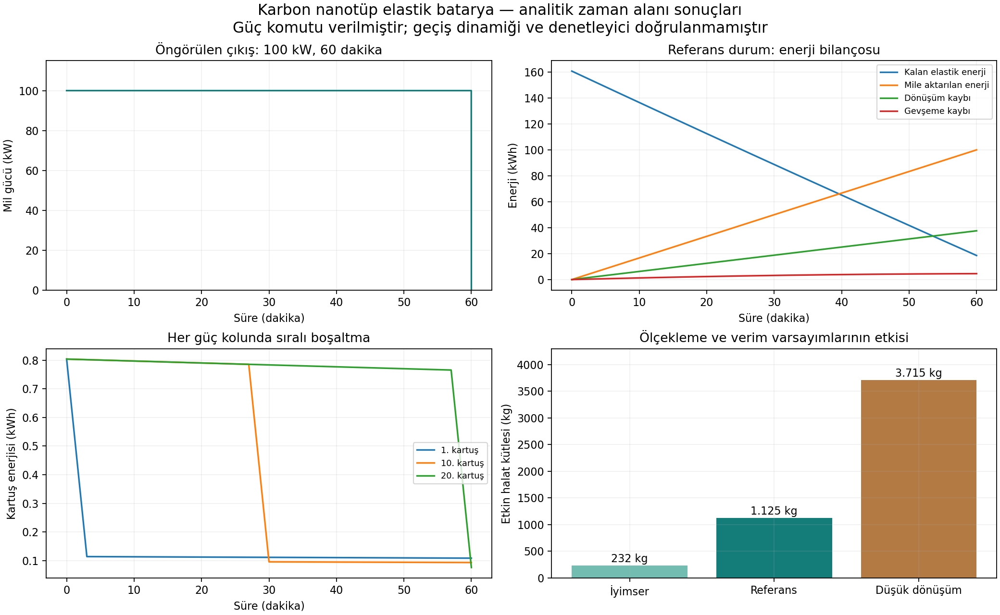
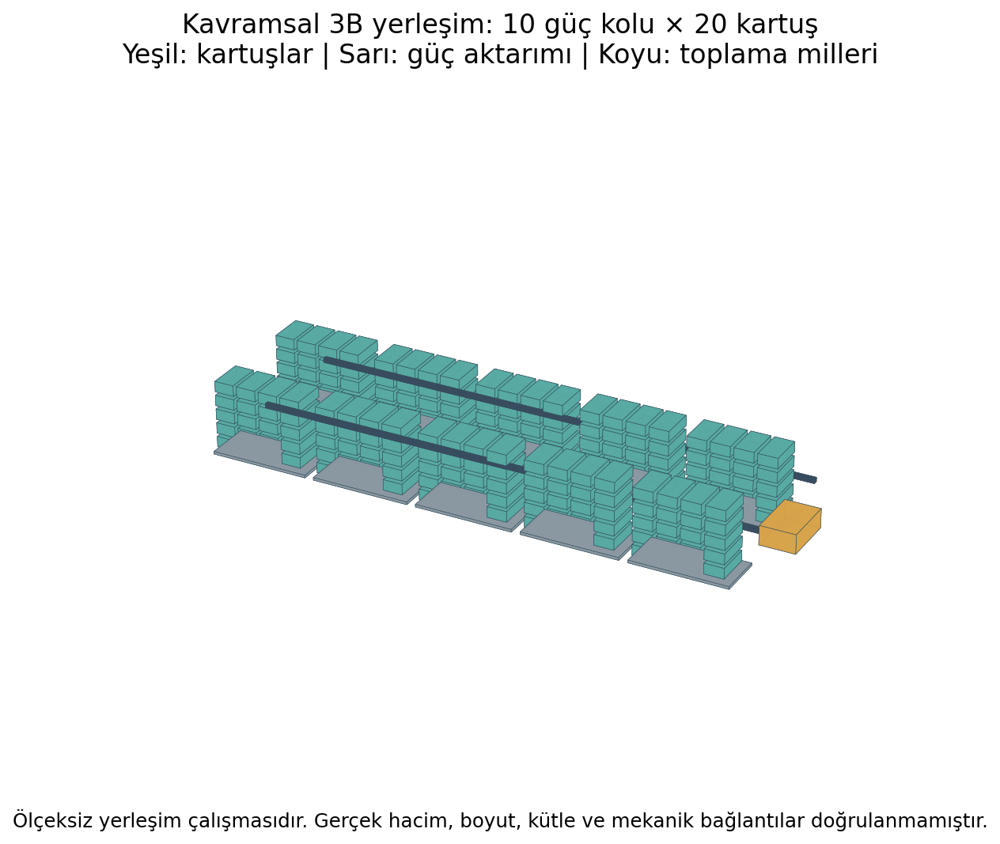

# ElasticEngine — Elastik Enerji Depolama

100 kWh kullanılabilir enerji ve 100 kW mekanik mil gücü hedefi için cam lifleri, karbon lifleri ve karbon nanotüp (CNT) halatlarla depolama araştırması. Hidrolik ve doğrudan mekanik boşaltma mimarileri yeniden üretilebilir hesaplarla karşılaştırılır.

> Araştırma kavramıdır; çalışan bir 100 kWh batarya veya üretime hazır motor değildir. Malzeme özellikleri, ölçek büyütme, yorulma ömrü ve gerçek donanım kütleleri ayrıca doğrulanmalıdır.

## Sonuçlara erişim

- **[Türkçe ayrıntılı teknik rapor](results/turkce_sunum/TEKNIK_SONUC_RAPORU_TR.html)** — İndirip tarayıcıda açın. Şemalar ve grafikler dosyaya gömülüdür.
- [Sistem şeması](results/turkce_sunum/sistem_semasi.svg) ve [kartuş çalışma şeması](results/turkce_sunum/kartus_semasi.svg).
- [FreeCAD yerleşimi](results/turkce_sunum/kavramsal_yerlesim.FCStd) ve [STEP dosyası](results/turkce_sunum/kavramsal_yerlesim.step).
- [Ayrıntılı CNT kavram hesabı](CNT_PULLEY_100KWH_CONCEPT.md) ve [JSON sonuç özeti](results/cnt_pulley_concept/summary.json).



## Güncel kavram

Utsumi ve arkadaşlarının 2024 çalışmasındaki Şekil 6 önerisinden hareketle kısa halat hücreleri, ortak tutucular ve makaralı mekanik iş toplama değerlendirilmiştir. Burulma ve eksenel iş birlikte ele alınır. Her biri 20 kartuş içeren 10 güç kolu ortak mile bağlanır.

| Büyüklük | Referans durum |
|---|---:|
| Çıkış enerjisi / gücü | 100 kWh / 100 kW |
| Çalışma süresi | 60 dakika |
| Mil devri / döndürme momenti | 1.000 dev/dak / 955 N·m |
| Kartuş sayısı | 200 |
| Bir kartuşun çıkışı | 0,5 kWh; 10 kW; 180 saniye |
| Başlangıç elastik enerji birikimi | 160,73 kWh |
| Etkin halat kütlesi | 1.124,63 kg |
| Boşaltma dönüşüm verimi varsayımı | %72,675 |
| Ortalama dönüşüm ve gevşeme ısısı | 42,17 kW |

Etkin halat toplam kütlenin yarısı olabilirse **2.249 kg toplam kütle bütçesi** elde edilir. Bu, hesaplanmış bir donanım kütlesi değildir. İyimser durumda 232 kg, düşük dönüşüm duyarlılığında 3.715 kg etkin halat gerekir.

Son çalışma kapalı biçimli enerji çözümünün zaman alanında değerlendirilmesidir. 100 kW komutu verilidir; kavrama geçişleri, gerçek denetleyici ve çok cisimli hareket doğrulanmamıştır. Önceki hidrolik çalışmalar OpenModelica ile çözülmüştür.



**3B model imalata esas değildir.** 233 katı nesne içerisinde 200 kartuş gösterilir. Koordinatlar yalnızca yerleşimi anlatır; gerçek hacim, mukavemet ve aktarım bağlantıları hesaplanmış değildir.

## Depo düzeni

| Yol | İçerik |
|---|---|
| `models/` | Modelica fiziksel modelleri |
| `scripts/` | Python hesaplama, grafik ve CAD betikleri; PowerShell çalıştırıcıları |
| `results/turkce_sunum/` | Türkçe rapor, şemalar ve 3B dosyalar |
| `results/cnt_pulley_concept/` | Son kavramın CSV zaman serileri ve JSON özeti |
| Diğer `results/` klasörleri | Önceki çalışmaların paylaşılabilir çıktıları |
| `toolchain.json` | Projeye göre göreli araç yolları |
| `tools-downloads.json` | Araç sürümleri ve kurulum kaynakları |

Kurulu araçlar (`tools/`), kurucular, derleme çıktıları, önbellekler ve geçici günlükler depoya dahil edilmez. Kaynak makalelerin tam metinleri yeniden dağıtılmaz; bağlantıları verilir.

## Yeniden üretme

Doğrulanan ortam: Windows, FreeCAD 1.1.4 ve Python 3.11 ortamı, OpenModelica 1.27.1, Modelica Standard Library 4.1. NumPy ve Matplotlib gerekir. CAD betiği `FreeCAD` ve `Part` modüllerini kullanır. Araçlar depoya gömülü değildir; yerel yolları `toolchain.json` ile uyumlu hale getirin.

PowerShell ile proje kökünde:

```powershell
# Son CNT hesabı ve Türkçe sunum
& './tools/FreeCAD_1.1.4-Windows-x86_64-py311/bin/python.exe' './scripts/cnt_pulley_concept.py'
& './tools/FreeCAD_1.1.4-Windows-x86_64-py311/bin/python.exe' './scripts/turkce_sonuc_sunumu.py'

# Önceki fiziksel modeller
./scripts/run-carbon-hydraulic.ps1
./scripts/run-carbon-torsion.ps1

# Araç zinciri doğrulaması
./scripts/run-validation.ps1
```

Modelica derleyicisi kısıtlı Windows ortamında MSYS izin hatası verebilir; normal kullanıcı oturumunda çalıştırılması gerekebilir. İlk kullanımda standart Modelica kütüphanesi gerekli olabilir. Betikler araçları otomatik kurmaz.

Analitik CNT kontrolleri: pozitif kartuş enerjisi, tanımlanan son rezerv, 360 MJ çıkış ve bağımsız gevşeme integrali. Türkçe sunum betiği 200 kartuş nesnesini kontrol eder. Önceki araç zinciri doğrulama ayrıntıları [SETUP_VALIDATION.md](SETUP_VALIDATION.md) dosyasındadır.

## Araştırma geçmişi

- [Literatür taraması](LITERATURE_SURVEY.md)
- [Cam seçimi ve kimyasal güçlendirme](GLASS_SELECTION_AND_ITERATION.md)
- [Lif sayısı ve hidrolik basınç araştırması](OPTIMIZATION_RESULTS.md)
- [Karbon-hidrolik raporu](CARBON_HYDRAULIC_REPORT.md)
- [CNT burulma ve elektrik çıkışlı model](CARBON_TORSION_DESIGN_RESULTS.md)
- [İlk yay-kremayer-pinyon modeli](SPRING_RACK_DESIGN.md)

Eski belgeler özgün dilinde korunmuştur. Güncel sonuç sunumu ve README Türkçedir.

## Temel kaynaklar

1. Utsumi ve diğerleri (2024), *Giant nanomechanical energy storage capacity in twisted single-walled carbon nanotube ropes*. [Nature Nanotechnology](https://doi.org/10.1038/s41565-024-01645-x).
2. Hill, Havel ve Livermore (2009), *Modeling mechanical energy storage in springs based on carbon nanotubes*. [Nanotechnology](https://doi.org/10.1088/0957-4484/20/25/255704).
3. Hill ve diğerleri (2009), *Storing elastic energy in carbon nanotubes*. [Journal of Micromechanics and Microengineering](https://doi.org/10.1088/0960-1317/19/9/094015).
4. Fthenakis ve diğerleri (2013), *Limits of mechanical energy storage and structural changes in twisted carbon nanotube ropes*. [Physical Review B](https://doi.org/10.1103/PhysRevB.88.245402).
5. Zhan ve diğerleri (2020), *High density mechanical energy storage with carbon nanothread bundle*. [Nature Communications](https://doi.org/10.1038/s41467-020-15807-7).

Kaynak yayınların yazarları bu tasarımı doğrulamış değildir. Malzeme düzeyindeki özgül enerji ile bütün sistemin kullanılabilir özgül enerjisi ayrı değerlendirilmelidir.
