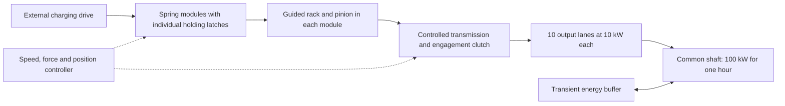

# 100 kW / 100 kWh spring–rack–pinion system definition

## Decision

An energy-balanced conceptual system can be defined using the existing leaf-spring method. **At the present 0.30% working strain it requires approximately 33,700 tonnes of spring material alone. This implementation is not a practical 100 kWh storage system.** The definition below establishes the scale and the control requirements; it is not a validated plant design, construction specification or proof of continuous output.

The output boundary is **100 kW mechanical shaft power for 3,600 seconds**, delivering 100 kWh. Electrical generation is outside that boundary. For electrical output, generator/converter efficiency and auxiliary consumption must be added; for example, an assumed 95% electrical conversion alone increases required mechanical power and capacity by 1/0.95.

## Basis inherited from the demonstrator

- UD S-2 glass/epoxy; longitudinal modulus 45.6 GPa; assumed density 1900 kg/m3.
- Nominal root bending strain 0.30%, corresponding to 136.8 MPa in the linear model. This remains an unqualified operating assumption, not a fatigue allowable.
- Geometrically enlarge the original leaf by a factor of ten: **2 m long × 300 mm wide × 40 mm thick**, with 200 mm initial tip displacement.
- Each enlarged leaf stores 547.2 J and has an estimated mass of 45.6 kg. Similar geometry at the same strain preserves specific energy: 0.003333 Wh/kg gross.
- Use an optimistic **90% aggregate mechanical discharge efficiency** for sizing. This is a system-level assumption, not measured efficiency. The original demonstration assigned 90% to the mesh alone; adding transmissions and clutches without improving that mesh would reduce overall efficiency further.
- Stop each discharge with 10% of the original spring deflection remaining: 20 mm. This leaves 1% of stored energy unreleased and avoids the zero-force endpoint.

Literature and the original calculations are documented in [SPRING_RACK_DESIGN.md](SPRING_RACK_DESIGN.md). In particular, [Muñoz-Guijosa et al.](https://oa.upm.es/78448/) supports composite spring prototypes, while [Polymers 2020, Table 2](https://www.mdpi.com/2073-4360/12/12/2834) supplies the longitudinal cured-ply modulus. Neither source validates this proposed plant or 40 mm thick laminate.

## Proposed architecture

Use **10 independently controlled output lanes**, each delivering 10 kW to a common output through a controlled transmission and clutch. Each lane has **739 spring modules**, discharged sequentially. Each module contains **100 enlarged leaves in parallel**, attached through compliant/sliding tip couplings to a guided rack crosshead. The crosshead drives a pinion with a nominal 200 mm pitch radius.

Modules remain stationary in supporting frames. Selection engages their output paths; it does not require moving multi-tonne charged modules during operation. The routing and transmission of hundreds of module outputs per lane are unresolved mechanical design problems. A shared rigid shaft directly connecting every pinion would constrain their motions incorrectly and cannot provide the intended sequential release.

| Sizing quantity | Per leaf | Per module | Whole system |
|---|---:|---:|---:|
| Leaf count | 1 | 100 | 739,000 |
| Module count | — | 1 | 7,390 |
| Gross charged energy | 547.2 J | 54.72 kJ | 112.328 kWh |
| Usable shaft energy, assumed losses and cutoff | 487.5552 J | 48.75552 kJ | 100.084248 kWh |
| Spring material mass | 45.6 kg | 4.56 tonnes | 33,698.4 tonnes |
| Solid spring material volume | 0.024 m3 | 2.4 m3 | 17,736 m3 |
| Rated module output while active | — | 10 kW | 100 kW across ten lanes |
| Ideal constant-power release duration | — | 4.875552 s | 3,603.032928 s |

Solid material volume is not installation volume: deflection spaces, rack travel, clamps, frames, transmission, access and containment all add space and mass. Modules are rounded up only to meet energy capacity; there is **no engineered redundancy, fatigue margin or operational reserve** in this count. A practical specification would require these allowances and therefore more modules.

## Force, motion and output control

With module stiffness K = 100 × 27,360 = 2,736,000 N/m, initial deflection x0 = 0.2 m, final deflection xf = 0.02 m and efficiency eta = 0.9:

    U_module = K x0² / 2 = 54,720 J
    E_module,out = eta K (x0² − xf²) / 2 = 48,755.52 J
    t_module = E_module,out / 10,000 = 4.875552 s
    x(t) = sqrt(x0² − 2 P_module t / (eta K))
    rack speed = P_module / (eta K x)

These are quasi-static constant-power relations. The previous viscous-brake simulation does not provide constant power and is not reused as proof of this behavior. Acceleration, clutch engagement, switching and control stability require a new dynamic model.

| Module operating quantity | Start | Cutoff |
|---|---:|---:|
| Spring force on rack/crosshead | 547.2 kN | 54.72 kN |
| Ideal input pinion torque at 200 mm radius | 109.44 kN m | 10.944 kN m |
| Equivalent torque after lumped 90% losses | 98.496 kN m | 9.8496 kN m |
| Required rack speed for 10 kW net | 0.02031 m/s | 0.20305 m/s |
| Pinion speed | 0.9695 rpm | 9.6951 rpm |

The rack travels 180 mm per useful discharge, rotating the pinion only **51.57 degrees**. A pinion alone therefore does not produce continuous rotation. Sequential engagement, a speed-changing transmission and overlapping handovers must convert short strokes into continuous shaft output.

For an illustrative common-shaft speed of 1,500 rpm, total shaft torque is 636.6 N m. Each 10 kW lane contributes 63.66 N m. Its pinion-to-output speed-increasing ratio would need to vary from approximately **1547:1 to 155:1**, a tenfold ratio change during a stroke. This is a demanding transmission requirement, not a selected or qualified gearbox. Fixed gearing cannot maintain both constant output speed and constant power over this force range.

The original module-2 teeth must not simply be reused at these loads. The nominal 200 mm pinion radius is a kinematic assumption; tooth module, face width, shaft, bearings, crosshead and foundation dimensions require strength and deflection analysis. One common rack sees the full 547.2 kN initial module force. Subdividing a module among several racks can distribute local loads but cannot remove the total reaction force or energy requirement.

## Sequence and buffering

1. An external drive bends and charges the modules. Individual latches hold charge without continuous drive torque. State of charge is inferred from calibrated force–displacement data, not displacement alone if hysteresis or relaxation is significant.
2. Each lane engages one module under controlled torque and releases its holding latch. Feedback adjusts transmission ratio/load so the lane supplies approximately 10 kW.
3. Before 20 mm residual deflection, engage the next module and cross-fade load. Isolate and latch the discharged module. Stagger the ten lanes' handovers to reduce aggregate ripple.
4. A separately sized transient buffer supplies startup and handover deficits and absorbs excess torque. A 100 ms interruption of all lanes would require at least 10 kJ at the output, before losses and margin. This is a buffer-energy example, not a complete flywheel specification. Buffer charging and depletion must be included in the delivered-energy guarantee.
5. Recharge requires external energy. For 100 kWh delivered, 90% discharge efficiency requires removing 111.11 kWh from the springs. If charging efficiency were also 90%, restoring that energy would require at least 123.46 kWh external input: 81% round-trip efficiency before storage relaxation and auxiliaries. First commissioning from zero charge also fills the residual-energy reserve.

At continuous 100 kW output, the assumed 90% mechanical efficiency corresponds to 11.11 kW of average discharge heat. Cooling and additional losses remain unsized. At full useful discharge of the rounded module inventory, energy accounting is:

    112.328 kWh initial = 100.084248 kWh shaft
                         + 11.120472 kWh losses
                         + 1.123280 kWh residual

## Feasibility gate

The energy-only minimum at this strain, efficiency and cutoff is 33,670 tonnes of spring material. Enlarging leaves or adding gear reduction does not change that result. A compact plant therefore needs a fundamentally better recoverable specific energy, not merely larger racks.

For perspective, a target of 10 tonnes of spring material would require 10 Wh/kg usable, versus 0.00297 Wh/kg here: approximately **3,367 times higher**. Increasing strain alone in the same linear beam model would require a factor sqrt(3367), or roughly 17.4% root strain. That extrapolation is outside the model and cannot be used as a permissible design. Changes in geometry can improve stress utilization, but this document does not claim they close the gap.

Recommended decision: retain the small demonstrator for transmission and release-control research; do not proceed to detailed CAD of a 7,390-module plant on this material/strain basis. Before reconsidering capacity scaling, measure recoverable energy, fatigue, compression limits and relaxation of actual candidate springs, then revise the material and geometry model. The present result rules out practical scaling of this particular baseline, not every elastic-storage technology.

## Reproduction

Run the installed Python with `scripts/size_100kw_system.py`. The script recalculates stiffness, energy, module count, force, speed and mass and verifies energy accounting and minimum delivered capacity. Results are saved to `results/system_100kw/sizing.json`. This is an algebraic sizing calculation, not a full-system CAE simulation.
